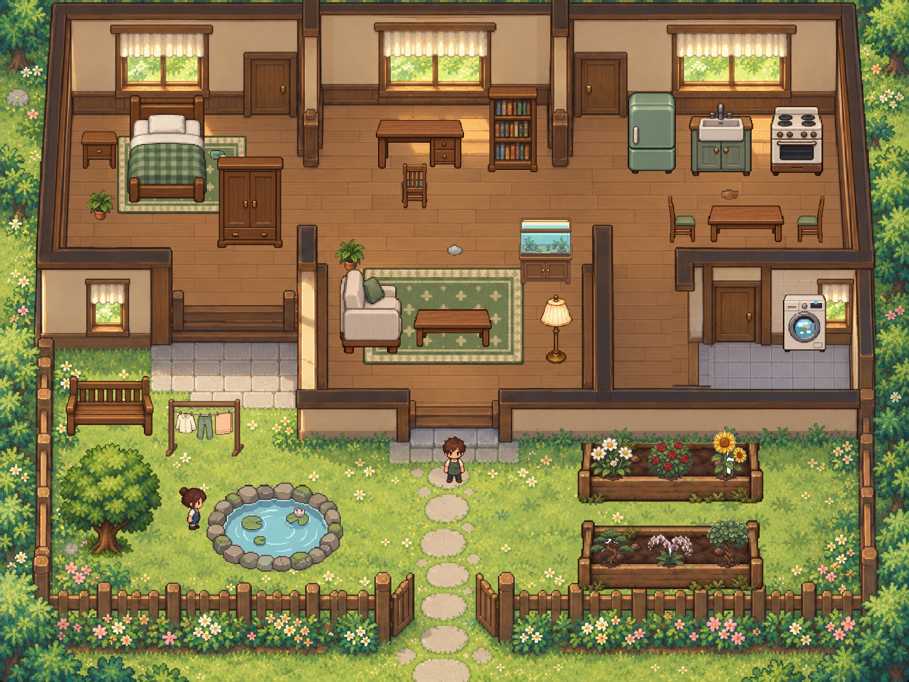
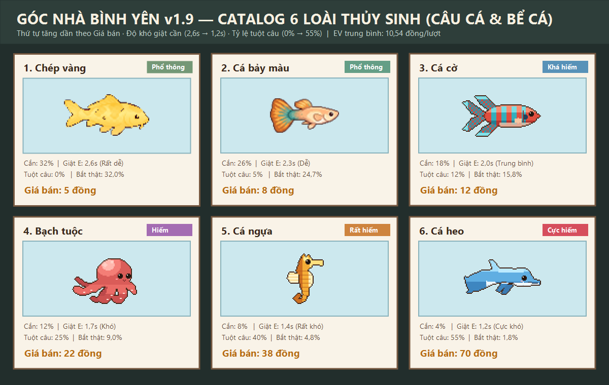

# Góc Nhà Bình Yên (v1.9 — ProjectFinal)

Trò chơi mô phỏng sinh hoạt 2D ấm cúng (*cozy life-sim*) chơi đơn trên Windows (Unity 2D), đồng bộ trọn bộ giữa **GDD v1.9** và **bộ tài nguyên mỹ thuật ProjectFinal**.



---

## Cấu trúc Repository

```text
GocNhaBinhYen/
├── Docs/
│   └── GDD_GocNhaBinhYen_v1.9_ProjectFinal.docx   # Tài liệu thiết kế chuẩn (31 test cases T01–T31)
├── ProjectFinal/                                  # Kho tài nguyên gốc, JSON cấu hình & trang xem trước
│   ├── 1_2D_Art/                                  # Map 1536×1152, 16 đoạn tường Y-sort, nhân vật, nội thất, câu cá, việc nhà, UI
│   ├── 2_Animations/                              # 10 loài cây × 3 giai đoạn (30 PNG) & metadata animation
│   ├── 3_Audio/                                   # 14 tệp âm thanh (HomeLoop.ogg + 13 SFX WAV)
│   ├── 4_Data_and_Fonts/                          # 15 tệp Config JSON (schemaVersion 9, mapRevision 1.9-PF) & Noto Sans
│   ├── 5_Previews/                                # Map_Demo_v19.png, Fish_Catalog_v19.png, Asset_Viewer.html
│   ├── References/                                # Ảnh tham chiếu phong cách mỹ thuật
│   └── Tools/                                     # Script xử lý nguồn asset
└── UnityProject/                                  # Nơi khởi tạo dự án Unity 2D khi bắt đầu code
```

---

## Điểm nhấn thiết kế bản v1.9

| Hạng mục | Thông số chuẩn v1.9 |
|---|---|
| **Bản đồ & Y-sort** | `48 × 36` ô (`1536 × 1152 px` @ `32 PPU`), 5 khu trong nhà + sân vườn, 16 đoạn tường rời `Walls/` + cửa mở thông hành lang–phòng giặt (`WASH01`) |
| **Nhân vật** | Nam & Nữ (`768 × 448 px`, `96 × 112/frame`, pivot `[48, 104]`), tốc độ `3,5 ô/s` |
| **Việc nhà** | Quét bụi phòng khách (`5` điểm), gom đồ bẩn phòng ngủ (`3` điểm) → giặt `30s` (`WASH01`) → phơi `60s` (`DRY01`), lau vết bẩn bếp (`3` điểm) |
| **Trồng cây** | Vườn phải: `2` luống × `3` ô = `6` ô trồng độc lập, mở sẵn `10` giống cây (3 giai đoạn/giống) |
| **Câu cá & Bể cá** | Ao cá `POND_01` (vườn trái) với **6 loài thủy sinh** tăng dần theo giá, độ khó giật cần (`2,6s → 1,2s`) & tỷ lệ tuột câu (`0% → 55%`); Bể cá `AQUARIUM_01` (phòng khách, tối đa `8` con, xem phóng to `960 × 500 px`, hỗ trợ đổi cá khi đầy & Sổ sưu tập cá) |
| **Cửa hàng & Trang trí** | `24` món bày bán chia `6` nhóm danh mục + `4` asset kiến trúc (`48` loại nội thất 4 hướng), hỗ trợ socket bàn/mép tủ/ghế/5 điểm treo tường `WALL_01–05` |
| **Âm thanh & Lưu game** | `14` tệp audio (`AudioManifest.json`), Save tự động nguyên tử `schemaVersion 9` / `mapRevision 1.9-PF` |



---

## Hướng dẫn khi bắt đầu code Unity

1. Mở **Unity Hub** → tạo dự án **2D (Built-in / URP 2D)** đặt ngay vào thư mục `UnityProject/`.
2. Kiểm tra cài đặt trong Unity (để tránh lỗi conflict Git):
   - `Edit → Project Settings → Version Control → Mode: Visible Meta Files`
   - `Asset Serialization → Mode: Force Text`
3. Chỉ copy tài nguyên runtime từ `ProjectFinal/` vào `UnityProject/Assets/_Game/` (không kéo `Source/`, `5_Previews/`, `References/`, `Tools/` vào Unity):
   - `1_2D_Art/` (trừ các thư mục `Source/` và `Atlases/` không cần dùng trực tiếp)
   - `2_Animations/Plants/`
   - `3_Audio/`
   - `4_Data_and_Fonts/Configs/*.json` → đặt vào `StreamingAssets/Configs/` hoặc `Resources/Configs/`
   - `4_Data_and_Fonts/Fonts/`
4. Thiết lập Texture Import chuẩn cho sprite: `Pixels Per Unit = 32`, `Filter Mode = Point (no filter)`, `Compression = None`, tắt `Generate Mip Maps`.

---

## Quy ước nhánh (Branch) theo 4 Mốc trong GDD v1.9

- `main`: Luôn sạch, ổn định (tag khởi điểm `v1.9-design-assets`).
- `feat/m1-map-player`: Mốc 1 — Map 16 tường Y-sort, collider, lối mở phòng giặt, nhân vật, camera, HUD.
- `feat/m2-chores-farm-fish`: Mốc 2 — Đồng hồ 120s, việc nhà, giặt phơi, 6 ô cây × 10 giống, câu cá 6 loài & Bể cá phóng to.
- `feat/m3-shop-decor-save`: Mốc 3 — Cửa hàng 24 món, Chế độ Bố trí + socket + pathfinding, Sổ tay, Save v9.
- `feat/m4-ui-audio-qa`: Mốc 4 — UI 1280×720, 14 tệp audio, hướng dẫn lần đầu và kiểm thử nghiệm thu `T01–T31`.
